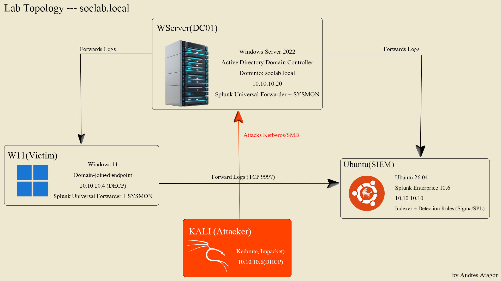

# SOC Detection & Response Lab


A hands-on Security Operations Center project simulating an Active Directory environment, executing real-world attack techniques against it, and building, validating, and documenting the detection rules that catch them.

This lab was built end-to-end — from infrastructure to attack simulation to detection engineering to incident investigation — to demonstrate practical, job-ready SOC Analyst skills, not just theoretical knowledge.

## Project Overview

| | |
|---|---|
| **Environment** | `soclab.local` — Active Directory domain, isolated VirtualBox network (10.10.10.0/24) |
| **SIEM** | Splunk Enterprise 10.6 |
| **Telemetry** | Sysmon (SwiftOnSecurity config) + Windows Event Logs |
| **Attack Techniques Executed** | 10, mapped to MITRE ATT&CK |
| **Detection Rules Built** | 10 (Sigma + SPL), deployed as scheduled Splunk alerts and validated against real attack traffic |
| **Investigation Reports** | 3, written from a defensive analyst's perspective |
| **Dashboard** | Splunk Dashboard Studio — 4 tabs, analyst triage view |
| **CI** | GitHub Actions validates every Sigma rule on each push |

## Architecture



Four virtual machines on an isolated network:
- **Kali Linux** — attacker host (Kerbrute, Impacket)
- **WServer (DC01)** — Windows Server 2022, Active Directory Domain Controller
- **W11** — Windows 11, domain-joined endpoint (Atomic Red Team executed here)
- **Ubuntu** — Splunk Enterprise (SIEM, indexer, detection rules)

## What's in This Repo

```
soc-detection-lab/
├── .github/workflows/
│   └── validate-sigma.yml          # CI: validates all Sigma rules on push
├── dashboards/
│   └── soc-analyst-view.json       # Splunk Dashboard Studio export
├── detections/
│   ├── sigma/                      # 10 Sigma detection rules (YAML)
│   └── spl/queries.spl             # Equivalent Splunk SPL queries
├── docs/
│   ├── topology.jpg                # Network architecture diagram
│   └── mitre-navigator/
│       └── soc-lab-coverage-layer.json
├── investigations/                 # 3 incident investigation reports (.docx)
└── scripts/
    ├── ioc_enrichment.py           # IOC reputation lookup (AbuseIPDB + VirusTotal)
    ├── ioc_enrichment_results.csv
    └── risk_based_alerting.py      # Vulnerability-aware alert severity escalation
```

## Attack Techniques & Detections

### Identity-Based Attacks Against Active Directory
Simulating an adversary who compromises one standard domain account and escalates to full domain compromise.

| Technique | MITRE ID | Detection Rule | Severity |
|---|---|---|---|
| Kerberos User Enumeration | T1087.002 | `kerberos-user-enum.yml` | Medium |
| Kerberos Password Brute Force | T1110.003 | `kerberos-brute-force.yml` | Medium |
| Domain Admin Privilege Escalation | T1136.001 / T1098.007 | `new-domain-admin.yml` | High |
| Remote Command Execution via Task Scheduler | T1053.005 | `task-scheduler-system-exec.yml` | Medium |
| DCSync Credential Extraction | T1003.006 | `dcsync-replication-abuse.yml` | Critical |

**[Full write-up →](investigations/Investigation1-Identity-Attacks-AD.docx)**

### Endpoint Attacks via Atomic Red Team
Simulating an already-compromised endpoint, using the Atomic Red Team framework to generate realistic, repeatable technique telemetry.

| Technique | MITRE ID | Detection Rule | Severity |
|---|---|---|---|
| Obfuscated PowerShell Execution | T1059.001 | `powershell-encoded-command.yml` | High |
| LSASS Memory Dump via comsvcs.dll | T1003.001 | `lsass-dump-comsvcs.yml` | Critical |
| Local Scheduled Task Creation | T1053.005 | `scheduled-task-local-creation.yml` | Medium |
| Registry Run Key Persistence | T1547.001 | `registry-run-key-persistence.yml` | Medium |
| RWX Process Injection (MockingJay-style) | T1055 | `process-injection-mockingjay-toolchain.yml` | High |

**Notable finding:** the Process Injection technique evaded Sysmon's process-injection telemetry (Event IDs 8 and 10) entirely. Instead of detecting the injection itself, the deployed rule detects its behavioral precondition: a process loading `msys-2.0.dll` — a **signed** DLL with an RWX section that MockingJay abuses — from outside legitimate Git/MSYS paths (Sysmon Event 7).

**[Full write-up →](investigations/Investigation2-Endpoint-Attacks-AtomicRedTeam.docx)**

### External Dataset Investigation — Splunk BOTS v1
Unlike the two investigations above, this one analyzes telemetry I did not generate myself — Splunk's publicly released "Boss of the SOC v1" dataset — simulating the more common real-world SOC scenario of investigating an environment someone else instrumented.

Reconstructed a two-phase website compromise against a fictional target (`imreallynotbatman.com`): automated vulnerability scanning (Acunetix), followed by a scripted Python brute-force attack that recovered valid Joomla administrator credentials.

**[Full write-up →](investigations/Investigation3-BOTSv1-WebsiteCompromise.docx)**

## Splunk Dashboard — Analyst View

A four-tab Dashboard Studio view built for triage, not decoration:

| Tab | What it shows |
|---|---|
| **Overview** | KPIs (alerts fired, active rules, telemetry sources, monitored hosts), a detection summary across all 10 rules, and coverage by MITRE ATT&CK tactic |
| **Identity Detections** | Failed authentication by source IP, account creation and privileged group changes, DCSync replication requests, remote execution as SYSTEM |
| **Endpoint Detections** | Obfuscated PowerShell, LSASS access, persistence mechanisms, suspicious RWX DLL loads |
| **Risk Prioritization** | Alerts escalated to Critical when the affected host has a Critical + KEV vulnerability |

Export: [`dashboards/soc-analyst-view.json`](dashboards/soc-analyst-view.json) — import via **Dashboards → Create New Dashboard → Source** and paste the JSON.

## Automation

**`ioc_enrichment.py`** — takes a list of IP addresses and enriches each one with reputation data from AbuseIPDB and VirusTotal, exporting results to CSV. Simulates the first triage step a SOC analyst performs on any new indicator.

**`risk_based_alerting.py`** — cross-references SOC alert severity against known vulnerability findings from a separate vulnerability management project ([`vuln-mgmt-pipeline`](https://github.com/aragonofficialaam-glitch/vuln-mgmt-pipeline)), escalating alert priority to Critical when the affected host has an associated KEV-listed critical vulnerability. The same logic is replicated live in the dashboard's *Risk Prioritization* tab.

**`validate-sigma.yml`** — GitHub Actions workflow that validates every Sigma rule (including multi-document correlation rules) on each push, so a broken rule never reaches the repo unnoticed.

## How to Reproduce

Full step-by-step environment build instructions, attack commands, and detection queries are documented within each investigation report. At a high level:

1. Build the `soclab.local` Active Directory lab (Domain Controller + domain-joined workstation)
2. Install Sysmon (SwiftOnSecurity config) and the Splunk Universal Forwarder on both hosts
3. Execute the identity-based attack chain from Kali using Kerbrute and Impacket
4. Execute endpoint techniques from Atomic Red Team on the W11 host
5. Deploy the 10 Sigma/SPL detection rules as scheduled Splunk alerts
6. Import `dashboards/soc-analyst-view.json` into Splunk Dashboard Studio
7. Run `scripts/ioc_enrichment.py` and `scripts/risk_based_alerting.py` for automated triage and risk scoring

## MITRE ATT&CK Coverage

This project covers 10 techniques across 6 tactics: Discovery, Credential Access, Privilege Escalation, Persistence, Execution, and Defense Evasion. Full coverage mapping is available via the [MITRE ATT&CK Navigator layer](docs/mitre-navigator/soc-lab-coverage-layer.json).

## Known Gaps & Lessons Learned

Detection engineering is iterative. These are the gaps and issues found while validating the lab, and how each was handled.

| # | Gap / Issue | Impact | Status |
|---|-------------|--------|--------|
| 1 | **Kerberos User Enumeration (T1087.002)** — the DC was not auditing Kerberos authentication *failures*, so AS-REQs for invalid users (Event 4768, result `0x6`) were never logged. | Rule is deployed but cannot fire: no telemetry, no detection. | Documented as a visibility gap in the dashboard. Fix: `auditpol /set /subcategory:"Kerberos Authentication Service" /failure:enable` |
| 2 | **Process Injection – MockingJay (T1055)** — the RWX-section injection evaded Sysmon Event IDs 8 and 10. | No direct injection telemetry. | Pivoted to a behavioral precondition: loading the signed but abusable `msys-2.0.dll` outside Git/MSYS paths (Sysmon Event 7). |
| 3 | **Alert fatigue (LSASS rule)** — the scheduled alert was saved with an *All time* window and re-fired every 5 minutes on the same historical event (16 duplicate alerts). | Noise in the alert queue. | Fixed: all 10 alerts now run every 5 min over a `-5m` window. |
| 4 | **False positives tuned** — LSASS access by legitimate system processes (csrss, wininit, services, MsMpEng, svchost); Run Key writes by OneDrive, Edge, VirtualBox drivers and Windows `RunOnce\GrpConv`. | Inflated hit counts. | Exclusions applied to both saved alerts and dashboard searches. |
| 5 | **Alerts deployed after the attacks** — most rules were saved as scheduled alerts after the techniques were executed, so they never fired on that activity. | Triggered-alert history is incomplete. | The dashboard's *Detection Summary* runs each rule's logic over historical data. |
| 6 | **No shared CMDB between projects** — this lab and the vuln-mgmt-pipeline project use different hosts. | Risk context cannot be joined automatically. | Asset → vulnerability mapping (DC01 → nginx:1.14 → CVE-2020-15999, Critical + KEV) is manual and documented. |

## Use of AI

AI was used as a copilot throughout this project — drafting detection logic, SPL queries, and documentation. Every rule, query, and finding was executed, tested against real lab telemetry, and validated by me; the false-positive tuning and gaps above came from that validation work.

## Author

**Andres Aragon Molina** — Computer Engineering student, Costa Rica. Pursuing a career as a SOC Analyst, with a long-term focus on Cloud Security.

[GitHub](https://github.com/aragonofficialaam-glitch) · [LinkedIn](https://www.linkedin.com/in/andres-aragon-molina-920729317/)
